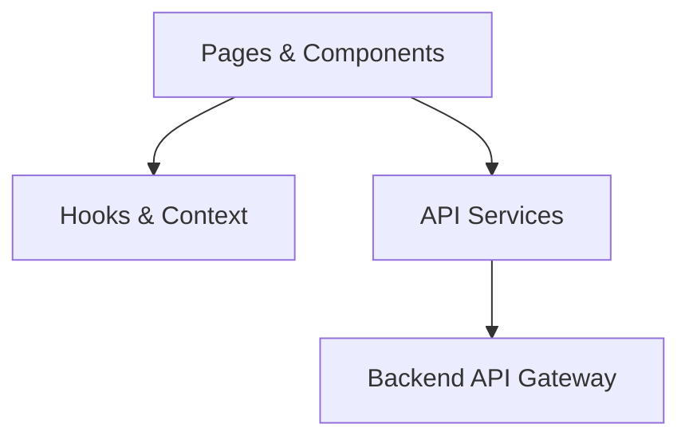
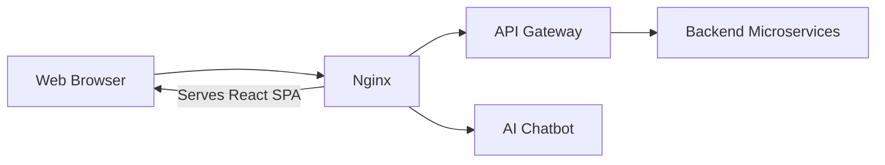
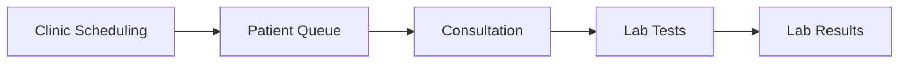

<div align="center">

# Arogya Mobile Clinics

A role-based healthcare management platform supporting mobile clinic operations across Sri Lanka.

[](https://react.dev)
[](https://www.typescriptlang.org)
[](https://vitejs.dev)
[](https://tailwindcss.com)
[](https://reactrouter.com)

</div>

---

## Overview

**Arogya** is a healthcare management platform designed to improve the accessibility, coordination, and delivery of mobile clinic services across Sri Lanka.

This repository contains the **React-based web application**, providing dedicated workspaces for patients, doctors, laboratory technicians, and administrators.

The frontend integrates with the Arogya Spring Boot microservices ecosystem through a centralized API Gateway.

## Key Features

| Role | Features |
|:---|:---|
| **Patient** | Profile management, clinic discovery, queue joining, consultation records, laboratory results |
| **Doctor** | Assigned clinics, patient queues, consultations, clinical documentation, lab test requests |
| **Technician** | Laboratory worklists, test-result management, diagnostic file uploads and previews |
| **Administrator** | Clinic scheduling, doctor assignments, dashboard statistics |
| **Public** | Landing page, registration, authentication, and email OTP password recovery |

**Additional capabilities:** English, Sinhala and Tamil language switching, responsive dashboards, field-level validation, and an AI chat assistant for supported authenticated roles.

---

## Technology Stack

| Category | Technologies |
|:---|:---|
| **Frontend** | React 18, TypeScript |
| **Build Tool** | Vite 5 |
| **Styling** | Tailwind CSS 3 |
| **Routing** | React Router 6 |
| **UI & Notifications** | Lucide React, React Toastify |
| **Localization** | Google Website Translator |
| **Communication** | REST APIs, JWT Bearer Authentication |
| **Deployment** | Nginx, HTTPS |

---

## Frontend Architecture

The application follows a **modular, component-based architecture**, separating presentation, application state, validation, and API communication.



### Key Design Decisions

| Decision | Purpose |
|:---|:---|
| **Role-Based Architecture** | Dedicated dashboards and protected routes for each user role |
| **Component Reusability** | Consistent interfaces with reduced code duplication |
| **Centralized API Layer** | Common request handling, JWT headers, and error processing |
| **Context-Based State** | Shared authentication, user profile, and language state |
| **Shared Validation** | Reusable field-specific validation across forms |
| **Safe Submissions** | Reduce duplicate requests and preserve unsaved input |
| **Asynchronous State Guards** | Prevent outdated responses from replacing current data |
| **Responsive UI** | Support desktop, tablet, and mobile devices |
| **Security Boundaries** | Keep authorization and data integrity enforcement on the backend |

---

## System Architecture

The production frontend is served through Nginx, which also forwards API and chatbot requests to their respective services.



### Core Healthcare Workflow



The frontend coordinates these workflows through dedicated API services. Backend microservices remain responsible for storing records, validating permissions, and enforcing data integrity.

---

## Authentication & Validation

Arogya uses JWT-based authentication, protected routes, and role-aware navigation.

The frontend provides shared validation across authentication, profiles, clinics, consultations, and laboratory forms.

### Validation Highlights

- **Accounts:** Email, username, password strength, and OTP validation
- **Identity:** Sri Lankan NIC and telephone number formats
- **Profiles:** Required fields, date-of-birth checks, age restrictions, and field limits
- **Clinics:** Scheduling validation, province/district matching, and doctor assignments
- **Consultations:** Required clinical information, session numbers, and laboratory orders
- **Attachments:** Supported file formats, attachment counts, and upload-size limits
- **User Experience:** Inline errors, accessible labels, invalid-field focus, and submission protection

> Frontend validation provides immediate feedback and improves usability. Backend services remain authoritative for security, authorization, and data integrity.

---

## Multilingual & Responsive Design

The interface supports **English, Sinhala, and Tamil**, with runtime translation through Google Website Translator.

- Responsive dashboards and navigation for different screen sizes
- Tailwind CSS for consistent styling and layout
- Lucide React for consistent iconography
- Accessible form labels, keyboard interaction, and validation feedback
- Shared components and role-specific layouts

---

## Project Structure

```text
src/
├── pages/           # Public and role-based pages
├── components/      # Shared UI and role-specific components
├── services/        # API integration modules
├── context/         # Authentication, profile, and language state
├── hooks/           # Reusable React hooks
├── utils/           # Validation and helper functions
├── types/           # Shared TypeScript definitions
└── config/          # Application configuration
```

---

## Build & Deployment

The application is built as a static React single-page application and deployed using **Nginx with HTTPS**.

### Production Build

```bash
npm ci
npm run build
```

The generated files are placed in `dist/`.

Production deployment supports:

- HTTPS communication
- Reverse proxy routing to the API Gateway
- Separate chatbot service integration
- Client-side route fallback for React Router
- Optional `VITE_API_BASE_URL` configuration at build time

### Available Commands

| Command | Description |
|:---|:---|
| `npm run dev` | Start the development server |
| `npm run build` | Generate the production build |
| `npm run preview` | Preview the production build |
| `npm run typecheck` | Run TypeScript checks |
| `npm run lint` | Run ESLint |

---

## Related Services

Arogya's frontend integrates with the following services:

| Service | Responsibility |
|:---|:---|
| **User Service** | Authentication and user profiles |
| **Clinic Service** | Clinic scheduling and doctor assignments |
| **Queue Service** | Patient queue management |
| **Consultation Service** | Clinical records and lab test requests |
| **Medical Records Service** | Laboratory results and attachments |
| **Discovery Service** | Backend microservice registration |
| **AI Chatbot Service** | Conversational assistance |

The backend microservices are accessed through the API Gateway. The chatbot is integrated separately.

---

<div align="center">

### Arogya Mobile Clinics

**Accessible Healthcare | Connected Communities | Better Care**

Built with React, TypeScript, Vite and Tailwind CSS.

</div>
